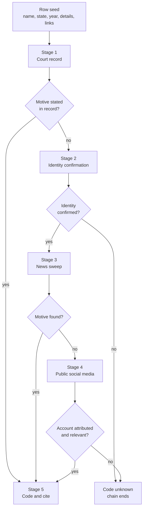

# Election Fraud Ideology Coding: Research Plan

Sep 22, 2026 · @Michael Conroy

This plan produces the first motive profile of the full population of adjudicated US election-fraud cases in the Heritage Foundation database, 2000–2025: 1,481 rows, each researched through a five-stage chain from court record to coded motive, with every code traceable to a captured source. Two companion documents carry the build: the technical specification for the automation pipeline, and the task list with its gating dependencies. This document is the research design.

## Research question and contribution

Dr. Treistman's framing sets the target: election fraud is a politically charged issue, the actual incidence of adjudicated cases is very small, and nobody has studied the convicted cases themselves to ask why they happened. The deliverable is therefore not a partisan tally. It is a characterisation of motive across every case in the population, with the cases where ideology is irrelevant treated as a substantive finding rather than a gap.

Three distinct variables come out of the research, each answerable in a different fraction of rows:

- **Motive type** — why the person did it. The primary research question, and answerable more often than ideology because "wanted to vote and believed they were eligible" is itself an answer.
- **Ideological motivation** — Dr. Treistman's existing column (liberal, conservative, independent, unknown). Applies only where motive is ideological or partisan; will be unknown or not applicable in most rows.
- **Partisan direction** — who the fraud stood to benefit, independent of why. Often visible from the race alone even when motive is opaque.

Separating them is what lets the dataset say something true about the 38% of rows that are eligibility and duplicate-voting cases. Under a party-only scheme those rows are an undifferentiated mass of unknowns. Under a motive scheme they resolve into eligibility confusion, convenience, caretaking and personal gain.

## Scope and ground rules

|  | Count |
| --- | --- |
| Rows in the workbook | 1,620 |
| Rows dated 2000–2025 | **1,481** — the population |
| Of those, criminal convictions | 1,252 |
| Other dispositions: diversion 135, civil penalty 43, official finding 25, judicial finding 21 | 224 |
| Rows with at least one source link | 1,322 |
| Rows with no source link at all | 159 |
| Rows sharing a source signature with another row (co-defendants) | 339 |
| Person rows with no middle name or initial | 890 (60%) |

Three rules govern everything else.

1. **One row, one incidence.** No collapsing co-defendants, no deduplication, no normalisation of existing values. The 14 Sumner County defendants are 14 incidences. Where a shared prosecution means one court record answers several rows, that is a research shortcut recorded in a `Case Group` column, never a reason to merge rows.
2. **Additive only.** The existing nine columns keep their values and their order. Everything the research produces lands in new columns to the right. Dr. Treistman confirmed on a call that adding columns is fine.
3. **Non-ideological is a finding, not a gap.** Cases where ideological factors are irrelevant get their own codes, distinct from *unknown*, because they are part of the answer to his question.

One scope decision still to confirm with him: whether the population is all 1,481 dispositions or the 1,252 criminal convictions only. The email said "each instance of voter fraud"; the diversion-program cases involve admitted conduct without a conviction and are arguably in scope.

## Coding scheme

The codebook is frozen before coding begins, versioned, and every amendment logged against the row that prompted it. Columns J onward, all additive:

| Column | Values |
| --- | --- |
| Motive Primary | The taxonomy below |
| Motive Secondary | Same list, optional, only where a second motive is separately evidenced |
| Motive Evidence | Verbatim quote or one-line summary the code rests on |
| Partisan Direction | Democratic, Republican, Nonpartisan race, Both, None, Indeterminate |
| Subject Type | Candidate, Officeholder, Election official, Party or campaign agent, Paid operative, Private individual |
| Identity Confidence | Confirmed, Probable, Unresolved |
| Evidence Tier | Stated by subject, Court document, News reporting, Circumstantial, None |
| Court Record URL | Docket, plea agreement, or charging document |
| News URLs | Pipe-separated, with retrieval dates |
| Social URLs | Pipe-separated, only where Identity Confidence is Confirmed |
| Case Group | Shared-prosecution key, for research efficiency only |
| Capture IDs | Pointers into the evidence store for every source used |
| Coder Notes | Free text, including why a code was withheld |

The motive taxonomy was derived from reading the Details column across the file, so every category has real cases behind it:

| Motive | Definition | Example from the file |
| --- | --- | --- |
| Ideological or partisan cause | Acted to advance a party, candidate or political cause not their own candidacy | Morphew forged his missing wife's ballot because he "wanted Trump to win" |
| Personal electoral gain | Subject or a relative was on the ballot | Helfin completed absentee ballots for voters to elect himself county commissioner |
| Financial | Paid to produce registrations, signatures or votes | Grassfire circulators submitting forged petition signatures for pay |
| Eligibility violation | Voted or registered while ineligible as a felon, non-citizen or non-resident | The 192 felon-voter rows |
| Convenience or expedience | Duplicate voting after a move, or to avoid inconvenience | Chapman voting in person in West Virginia and absentee in Florida |
| Household or caretaking | Cast or forged a ballot for a family member or dependent | Lewis submitting her deceased landlord's ballot; Clark signing her grandson's |
| Protest or demonstration | Committed the act to expose or prove a vulnerability | Eschenbach double-voted and posted that he did it to show absentee voting was insecure |
| Official misconduct | Election official abusing position; code a secondary motive where one is evident | Peters and the Mesa County system breach |
| Identity concealment | Voting incidental to living under an assumed identity | Francisco, voting under a stolen citizen identity |
| Unknown | Record is silent or too thin | Default |

**Decision rules.** Take the highest tier the evidence supports and stop: a reason stated by the subject beats a court document, which beats news characterisation, which beats circumstantial inference. Where motive is ideological or partisan, fill Dr. Treistman's `Ideological Motivation` column; everywhere else leave it `unknown` and let the motive column carry the answer. Party registration never establishes a motive code on its own — it is an identity signal, which is a different job and belongs in the identity stage. Registration is also unrecorded in 18 states, and Illinois, Indiana and Ohio record primary-ballot choice instead, so "a registered Democrat" in a court record from those states probably means primary history.

## Method: the five-stage chain

Each row runs through five stages, each gated on the one before. The gates stop the chain early on rows already answered, and stop it entirely on rows where identity was never pinned down.



**Stage 1 — court record.** Expand the `herit.ag` and `bit.ly` shorteners first; Heritage's links usually point at coverage rather than the docket, but the coverage names the county, court and charge. Then, in order: DOJ or US Attorney press release for federal cases, state AG or county DA release for state cases, then the docket itself. Federal records come from CourtListener and RECAP. State dockets are a fifty-jurisdiction problem with no free aggregator; a per-state adapter registry with a published coverage matrix is built once and reused. Plea agreements, charging documents and sentencing memoranda sometimes state motive outright and always yield the identifiers stage 2 needs: middle name, age or year of birth, city.

**Stage 2 — identity confirmation.** The job is narrow and not about party: establish that the name in the row corresponds to one specific real person, so anything found downstream attaches to the right human being. The method is a population prior from name frequency, computed rather than asserted:

```latex
N_{\text{namesakes}} \approx P(\text{surname}) \times P(\text{given name} \mid \text{sex}, \text{birth year}) \times N_{\text{adults}}(\text{state}, \text{cohort})
```

`P(surname)` from the [Census 2010 surname file](https://www.census.gov/topics/population/genealogy/data/2010_surnames.html); `P(given name | sex, birth year)` from the [SSA name files](https://www.ssa.gov/oact/babynames/limits.html). Prior odds are roughly `1 / N_namesakes`; middle name, age and city multiply in as Bayes factors. For a John Smith in Texas born around 1975 the namesake count runs into the thousands and a middle initial barely moves the posterior; for a Zul Mohamed in Minnesota it may be near one. Same evidence, different conclusion. Voter records serve only as a corroborator here, answering whether a registrant consistent on middle name and age exists in the jurisdiction. Two thresholds, not one: accept above the upper, reject below the lower, review the band between. "None of these candidates is the person" is an explicit modelled outcome, and unresolved stops the chain.

| Identity Confidence | Standard |
| --- | --- |
| Confirmed | Full name including middle, plus two of: age or DOB, city, case number, employer or office held |
| Probable | Full name plus one corroborating identifier, and no competing candidate found |
| Unresolved | Anything less |

The empirical baseline the method has to beat: the National Task Force report on Interstate Identification Index name checks found **4.9% false positives** against 93,274 Florida applicants — roughly one in eighteen people with no record failed a name check.

**Stage 3 — news sweep.** Name plus jurisdiction plus year, then again with the charge language. Post-2017 the open web and GDELT serve well; pre-2015, the UNH NewsBank licence is the archive and the work is manual. Read for stated reasons, affiliations reported by the outlet, offices sought, organisational ties. Every page is captured at retrieval.

**Stage 4 — public social media.** Only for rows at Confirmed identity, and only where stages 1 to 3 left motive genuinely open. The component accepts a handle or email only — never a real name — because name-to-account discovery is not viable on this population and produces exactly the cross-platform profile this design avoids. Handles come from the record itself: a court exhibit quoting posts, coverage naming the account, a candidate's published campaign contact. Two gates before anything counts: the account must be attributable by an independent identifier, and the content must bear on the offence or on political motivation around the time of it. A pre-registered site allowlist scoped to platforms where political speech relevant to motive appears bounds the search. Platform terms bind: Reddit only through Reddit for Researchers, Meta only through the Content Library, X only on a paid tier or not at all, Bluesky openly.

**Budget.** If the chain works, most rows resolve or terminate by stage 2 or 3. Stage 4 should run on a small minority; if it is running on hundreds of rows, the earlier stages are underperforming.

## Sources of evidence

The research draws on three kinds of source. Full tool-by-tool detail, with versions, licences and maintenance status, is in Tool register.

**Licensed through UNH.** Checked against the library's A-Z database list. The two that decide feasibility are **Access World News (NewsBank)** — thousands of full-text papers back to the early 1980s including small-market local coverage, which is the only archive that serves the pre-2015 half of the file — and **ICPSR**, which carries the National Archive of Criminal Justice Data and the Klarner state legislative election returns. Also available: Campus Research (Westlaw) with case law and public records open to all students, Newspapers.com, ProQuest Historical Newspapers (NYT to 2003), the Hartford Courant from 1992, US Major Dailies, Newspaper Source Plus, HeinOnline, NCJRS and the Homeland Security Digital Library. **Not licensed:** Nexis Uni, ProQuest TDM Studio, Factiva. The librarian is Joe Scollo, `jscollo@newhaven.edu`, (203) 479-4186, whose subject areas are Criminal Justice, National Security, News & Newspapers and Political Science.

**Open and government.** The DOJ press-release API (free, no key, substantive from 2013), CourtListener and RECAP (free EDU membership required — the default tier is 125 requests a day), CourtListener's quarterly public-domain bulk exports, the Wayback Machine, Common Crawl, GDELT from 2017, and for public figures DIME v4.0 (Stanford; federal, state and local candidates 1979–2024 with party and office), FEC bulk candidate files, FollowTheMoney state candidates through 2024, the Harvard local elections database 1989–2021, OpenElections, OpenStates and the `congress-legislators` crosswalk.

**Deliberately excluded.** Commercial voter-file vendors, people-search services and data brokers. Registration and contribution records are records about private individuals; they enter this study only as corroboration for someone the record has already established as a public figure, never as a discovery tool across the population. Stating this exclusion in the methods section is itself a defensible position.

## Validation and reliability

Dr. Treistman has already asked for randomised manual checks of the coding. Five checks cover the chain and give him numbers he can put in a paper.

| Check | Design | Reported as |
| --- | --- | --- |
| Codebook freeze | Version, date, amendment log keyed to the row that prompted each change | Codebook appendix |
| Gold set | 200–300 rows, stratified by year, fraud type and evidence tier; double-coded by humans, disagreements resolved by consensus; held out from any prompt development | Human–human Cohen's κ per field |
| Coding reliability | Random 15% (about 220 rows) coded independently by a second coder blind to the first code; if no second coder, self-recode after a several-week washout and report as intra-coder | Krippendorff's α per field; below \~0.70 means sharpen the codebook, not code more |
| Identity audit | 50 rows marked Confirmed re-derived from scratch against the documents; oversample common surnames and the threshold band | False-confirmation rate with a confidence interval, reported separately for common and rare names |
| Extraction validation | Model output scored against the gold set per field; abstention treated as its own class; span grounding scored separately | Precision, recall and F1 per field; model ID, prompt, temperature and date recorded |

Two things to state plainly in the write-up rather than let a reviewer find. First, the 339 rows sharing a prosecution are not independent observations even though each is its own incidence, so inferential statistics need standard errors clustered on `Case Group` — an analysis choice, not a reason to alter the data. Second, re-run the substantive analysis at a stricter identity threshold (0.99 against 0.95) and show the conclusions do not hinge on marginal matches; that sensitivity check is the single most persuasive robustness argument available. The unresolved count is a headline finding, not a footnote: a study that resolves 1,481 of 1,481 is less credible than one that resolves 1,180 and says so.

## Limitations and ethics

**Sample selection.** The Heritage database is a convenience sample shaped by prosecutorial discretion and by Heritage's own inclusion decisions, and the [Brennan Center has criticised it at length](https://www.brennancenter.org/our-work/research-reports/heritage-fraud-database-assessment). Heritage itself calls it a sampling and not comprehensive. The motive profile therefore describes adjudicated and catalogued cases — which is exactly the population nobody has studied — and should be named as such rather than generalised to election fraud overall.

**Public figures and private individuals.** Candidates, officeholders, party officials and paid operatives are public figures whose politics are a matter of public record, and characterising them is ordinary political science. A large share of rows are private individuals — a man who voted not knowing his rights were unrestored, a woman who forged her late landlord's ballot. For them, *unknown* or a non-ideological motive is usually the honest code, and the identity gate plus the handle-only social stage exist to keep the research from becoming profiling.

**Platform and licence terms.** NewsBank and Newspapers.com prohibit bulk download and scraping; retrieval there is manual by design. Reddit's developer API is explicitly not an authorised research channel. Several pipeline tools carry copyleft licences (PyMuPDF and Browsertrix are AGPL; the WhatsMyName site data is CC BY-SA) and a licence register goes in the methods appendix.

**Publication split.** The toolchain code and the aggregate findings can be public. The working dataset, holding identity resolutions and account attributions for named private individuals, should not be. Row-level identity fields stay private under Dr. Treistman's supervision.

## Deliverables and timeline

Five deliverables, all of which exist in draft from the first pilot onward and are refined rather than written at the end.

1. **The coded workbook** — Dr. Treistman's original nine columns untouched, the new columns to the right, every row carrying its evidence tier and capture pointers.
2. **The codebook** — taxonomy, decision rules, amendment log.
3. **The methods appendix** — identity linkage model and error rates, extraction validation, reliability statistics, sensitivity analysis, licence register, the deliberate-exclusion statement.
4. **The toolchain** — a public repository with the per-state coverage matrix, reproducible from the workbook to the coded output.
5. **The reliability report** — the numbers from the validation table above, in a form that goes straight into a paper.

| Milestone | Target | What exists by then |
| --- | --- | --- |
| Access requests sent | Sep 26, 2026 | CourtListener EDU, PACER exemption, library and Ballotpedia emails out; FollowTheMoney mirrored |
| Pilot complete | Oct 9, 2026 | Skeleton and link resolution running; 50 rows done by hand with timing; first numbers to Dr. Treistman: link-rot rate, stage-resolution rates, provisional motive distribution |
| Stages 1–2 at volume | Oct 30, 2026 | Federal records and DOJ releases automated; AG harvester for the top ten states; identity model built and audited |
| Stages 3–4 at volume | Nov 20, 2026 | News retrieval on all post-2017 rows; pre-2015 rows in progress through NewsBank; gold set coded; extraction validated |
| Semester deliverable | Dec 11, 2026 | Coded workbook v1, codebook, reliability report, methods appendix draft, toolchain repository |

The pre-2015 rows are the schedule risk. NewsBank retrieval is manual, and if the pilot shows it running long, the honest plan is to deliver the post-2015 population fully coded in December with the earlier rows continuing into spring, rather than thinning the evidence standard to finish on time.

## Open questions for Dr. Treistman

- [ ] Is the population all 1,481 dispositions, or the 1,252 criminal convictions only?
- [ ] What does *independent* mean in the dropdown — ideologically centrist, registered unaffiliated, or non-partisan in direction? Three different sets of rows
- [ ] Would he code 50 rows himself as a calibration set? It is the cheapest way to surface any mismatch between his reading of the categories and mine
- [ ] Does he want the companion columns in the deliverable workbook, or in a separate analysis file alongside his original layout?
- [ ] Budget items that may arise: Ballotpedia academic access (price unknown), X API Basic at $200/month if stage 4 needs X, PACER fees if the exemption is refused

## Related documents

- Doc — the automation architecture: requirements, data model, component contracts, API catalogue, provenance design, identity and extraction design, orchestration, testing, licensing
- Doc — every task in seven sections with explicit gates: accounts and decisions, environment, reference data, codebases in build order, pilot and calibration, verification checkpoints, documentation and delivery
- Tool register — the second tab of this document: every tool verified with version, licence and maintenance status, plus the UNH-licensed resources and the methodology citations

## References

- [Heritage Foundation Election Fraud Database](https://electionfraud.heritage.org/) and its [about page](https://www.heritage.org/article/about-the-election-fraud-database)
- [Brennan Center, Heritage Fraud Database: An Assessment](https://www.brennancenter.org/our-work/research-reports/heritage-fraud-database-assessment)
- [Free Law Project on CourtListener API access and EDU memberships](https://free.law/2026/05/07/api-included-in-memberships/)
- [UNH Library A-Z databases](https://libguides.newhaven.edu/az/databases) and the [NSEC 6601 course guide](https://libguides.newhaven.edu/NSEC6601Treistman)
- All row counts computed directly from `heritage-voter-fraud-map-search-20260406150111.xlsx` as received
