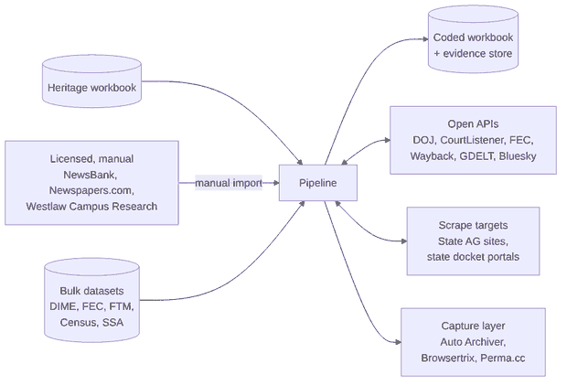
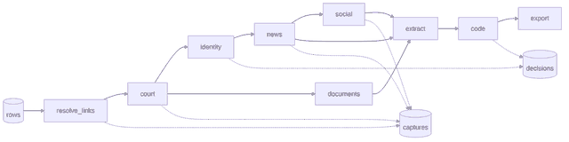
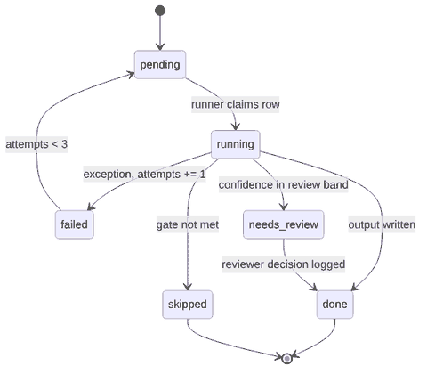

# Election Fraud Pipeline Technical Specification

Technical specification · Michael Conroy · October 27, 2026

> Repository copy of the Google Doc of the same name (October 27, 2026), kept here so Claude Code can read it. Figures are in `docs/figures/`. The companion documents are `docs/summary.md`, `docs/research-plan.md` and `docs/tool-register.md`; `docs/plan.md` (the first-pass build plan) narrows this specification for the first pass and wins where the two differ.

This specification defines the automation pipeline that researches 1,481 election-fraud cases from the Heritage Foundation database through court records, identity confirmation, news coverage and public social media, and emits a coded workbook with full provenance. Stack: Python 3.12, SQLite for the single-operator build with a documented Postgres migration path, Docker only for the two capture tools that need it. A non-technical summary for Dr. Treistman is the companion document "Election Fraud Pipeline Technical Solution - Summary". The research design it implements is in the companion document *Election Fraud Ideology Coding: Research Plan* (<https://claude.ai/code/artifact/62cf4429-ec7c-46e6-9485-603810f0f60f>).

## 1. Purpose, scope and requirements

**Purpose.** Turn one input workbook of 1,481 case rows into one output workbook with thirteen added columns, where every added value is traceable to a captured source document, a computed identity decision, or a logged human judgment. The system is a research instrument, so reproducibility and auditability are primary requirements, not afterthoughts.

**In scope.** Ingest; link resolution and archival; federal and state court-record retrieval; DOJ and state AG press-release harvesting; probabilistic identity resolution with a population prior; news retrieval and article extraction; document OCR and structure; handle-based social pivot; LLM-assisted structured extraction with span citations; rule-based coding; export; a validation harness; a provenance store.

**Out of scope.** Name-based account discovery. Any commercial people-search or data-broker service, unless Dr. Treistman decides otherwise (see the open decisions in section 12). Mutation of the nine source columns. Continuous monitoring or scheduling; this is a batch instrument run by one operator over one semester.

### Functional requirements

| ID | Requirement |
| :- | :- |
| F1 | Ingest the source workbook once into an immutable rows table; the pipeline never writes to it |
| F2 | Resolve every source URL, following shorteners and redirects, and archive the resolved page at first retrieval |
| F3 | For each row, attempt court-record retrieval in order: DOJ/USAO release, state AG or DA release, federal docket via CourtListener/RECAP, state docket via the adapter registry |
| F4 | Produce a calibrated identity posterior per row with an explicit *unresolved* outcome, and route a defined band to human review |
| F5 | Retrieve news coverage via automated sources for 2017–2025 and via a manual-import path for licensed databases |
| F6 | Extract court PDFs to text with page, bounding-box and character-span provenance |
| F7 | Accept a handle or email only as input to the social component; reject real-name input at the interface |
| F8 | Extract typed fields from text with a verbatim source span and an alignment status per field |
| F9 | Apply the codebook's decision rules as pure functions over extracted evidence, emitting a code and an evidence tier |
| F10 | Export the original workbook with the new columns appended and the original nine columns byte-identical |
| F11 | Report per-stage resolution counts, identity confidence distribution, and coding reliability on demand |

### Non-functional requirements

| ID | Requirement | How it is met |
| :- | :- | :- |
| N1 | **Provenance**: every retrieved artefact has URL, timestamp, HTTP status, SHA-256 and archived body | captures table plus WARC/WACZ files; RFC 3161 timestamps on the corpus manifest |
| N2 | **Resumability**: any stage can stop and restart without re-fetching or duplicating work | Per-row state table; HTTP cache; idempotent stage functions keyed on input hash |
| N3 | **Reproducibility**: a re-run from the same inputs, pinned dependencies and pinned data files yields the same codes | Lockfile; pinned site-data hashes; model ID, prompt and temperature recorded per extraction |
| N4 | **Politeness and compliance**: per-domain rate budgets, descriptive User-Agent, robots respected, no scraping of sources whose terms forbid it | pyrate-limiter with SQLite backend; manual-import path for NewsBank, Newspapers.com and Westlaw |
| N5 | **Auditability**: every accepted identity match and every code is explainable to a specific document and rule | Splink waterfall per match; decisions table with reviewer and rationale; extraction spans |
| N6 | **Single-operator scale**: ~7,400 stage executions, ~5,000 captures, one laptop | SQLite in WAL mode; no daemons; Docker only for Browsertrix and Auto Archiver |
| N7 | **Data separation**: code publishable, row-level identity data not | Repository excludes the database and capture store; export script produces a redacted analysis file |

## 2. System context and architecture

### Context

The pipeline sits between one workbook and one workbook, and talks to four classes of external system: government and open APIs, scrape targets, licensed databases reached only through a browser, and a local capture layer.



*Figure 1. System context: the pipeline between one workbook and one workbook, and the four classes of external system it talks to.*

### Components

Eleven single-purpose components over one database. Each reads rows in a given state, does one thing, writes output plus a confidence and a provenance record, and advances the state.



*Figure 2. The eleven components over one database; dotted edges are writes to the provenance stores.*

### Per-row state machine

The unit of work is the row, not the run. Each row carries one state per stage. A stage runner selects rows whose predecessor stage is done and whose own stage is pending or failed under the retry limit, and processes them in a bounded batch. This is the whole orchestrator.



*Figure 3. Per-row, per-stage state machine.*

Gates are evaluated by the runner before claiming a row: identity requires court done; news requires identity done with confidence not unresolved; social requires news done, identity confirmed, and at least one handle in identifiers; code requires extract done. A row that terminates at a gate is skipped for the downstream stages with the gate name recorded as the reason, so the final report can say exactly how many rows stopped where.

## 3. Data model

One SQLite file, pipeline.db, in WAL mode. Bodies of captured pages and documents live on disk under a content-addressed path (store/<sha256[:2]>/<sha256>), not as BLOBs, so the database stays small and the store can be bagged and timestamped independently. Three tables are append-only by convention and enforced by triggers: captures, decisions, audit_log.

```sql
-- Immutable source. Written once by ingest; a trigger rejects UPDATE and DELETE.
CREATE TABLE rows (
  row_id            INTEGER PRIMARY KEY,          -- 1-based position in the source sheet
  year              INTEGER NOT NULL,
  state             TEXT    NOT NULL,
  name              TEXT    NOT NULL,
  case_type         TEXT,
  fraud_type        TEXT,
  details           TEXT,
  source_raw        TEXT,                         -- the Source cell verbatim
  ideological_motivation TEXT,                    -- Treistman's column, as received
  ideological_source     TEXT,
  in_scope          INTEGER NOT NULL,             -- 1 if 2000 <= year <= 2025
  row_sha256        TEXT    NOT NULL,             -- hash of the nine source cells
  ingested_at       TEXT    NOT NULL
);
-- Work queue. One record per (row, stage).
CREATE TABLE case_stage (
  row_id       INTEGER NOT NULL REFERENCES rows(row_id),
  stage        TEXT    NOT NULL CHECK (stage IN
               ('resolve_links','court','identity','news','documents','social','extract','code')),
  status       TEXT    NOT NULL DEFAULT 'pending' CHECK (status IN
               ('pending','running','done','failed','needs_review','skipped')),
  attempts     INTEGER NOT NULL DEFAULT 0,
  gate_reason  TEXT,                              -- why skipped, if skipped
  last_error   TEXT,
  input_hash   TEXT,                              -- hash of inputs; unchanged hash => idempotent no-op
  tool_version TEXT,
  started_at   TEXT, finished_at TEXT,
  PRIMARY KEY (row_id, stage)
);
-- Every retrieval, forever. Never updated.
CREATE TABLE captures (
  capture_id       INTEGER PRIMARY KEY,
  row_id           INTEGER REFERENCES rows(row_id),
  stage            TEXT NOT NULL,
  url_requested    TEXT NOT NULL,
  url_final        TEXT,                          -- after redirects
  retrieved_at     TEXT NOT NULL,                 -- UTC ISO-8601
  http_status      INTEGER,
  content_type     TEXT,
  content_sha256   TEXT NOT NULL,
  body_path        TEXT NOT NULL,                 -- store/<aa>/<sha256>
  headers_json     TEXT,
  warc_path        TEXT, wacz_path TEXT,          -- when captured via Auto Archiver / Browsertrix
  tsa_token_path   TEXT,                          -- RFC 3161 token, when timestamped
  wayback_url      TEXT,                          -- SPN result, when submitted
  tool             TEXT NOT NULL, tool_version TEXT NOT NULL,
  site_data_sha256 TEXT,                          -- WMN / Maigret data hash for social captures
  manual_source    TEXT                           -- 'newsbank' | 'newspapers_com' | 'westlaw' | NULL
);
-- Facts about the person, each pointing at the capture that supports it.
CREATE TABLE identifiers (
  identifier_id  INTEGER PRIMARY KEY,
  row_id         INTEGER NOT NULL REFERENCES rows(row_id),
  kind           TEXT NOT NULL CHECK (kind IN
                 ('middle_name','dob','age','city','case_number','office','employer',
                  'party_on_ballot','handle','email','alias')),
  value          TEXT NOT NULL,
  capture_id     INTEGER NOT NULL REFERENCES captures(capture_id),
  span           TEXT                             -- verbatim text the value came from
);
-- Identity resolution outputs.
CREATE TABLE identity_candidates (
  candidate_id     INTEGER PRIMARY KEY,
  row_id           INTEGER NOT NULL REFERENCES rows(row_id),
  source           TEXT NOT NULL,                 -- 'court' | 'dime' | 'fec' | 'ftm' | 'voter_file' | 'harvard_local'
  fields_json      TEXT NOT NULL,
  prior_namesakes  REAL,                          -- N_namesakes from Census x SSA
  match_weight     REAL,                          -- Splink log2 Bayes factor
  posterior        REAL,                          -- combined with the population prior
  waterfall_json   TEXT                           -- per-comparison evidence, for the audit
);
-- Human and model decisions. Never updated; a reversal is a new row.
CREATE TABLE decisions (
  decision_id   INTEGER PRIMARY KEY,
  row_id        INTEGER NOT NULL REFERENCES rows(row_id),
  kind          TEXT NOT NULL CHECK (kind IN ('identity','code','review','override')),
  outcome       TEXT NOT NULL,                    -- e.g. 'confirmed', 'unresolved', 'motive=financial'
  rationale     TEXT,
  decided_by    TEXT NOT NULL,                    -- 'splink:4.0.17+model:<sha>' or reviewer initials
  decided_at    TEXT NOT NULL,
  evidence_ids  TEXT                              -- JSON list of capture_id / extraction_id
);
-- Typed fields pulled from text, each with its verbatim span.
CREATE TABLE extractions (
  extraction_id    INTEGER PRIMARY KEY,
  row_id           INTEGER NOT NULL REFERENCES rows(row_id),
  capture_id       INTEGER NOT NULL REFERENCES captures(capture_id),
  field            TEXT NOT NULL,                 -- 'stated_motive','party','office_sought','org','role'
  value            TEXT,
  verbatim_span    TEXT,
  char_start       INTEGER, char_end INTEGER,
  alignment_status TEXT CHECK (alignment_status IN
                   ('match_exact','match_greater','match_lesser','match_fuzzy','unaligned')),
  model_id         TEXT, prompt_sha256 TEXT, temperature REAL,
  extracted_at     TEXT NOT NULL
);
-- Final coded values, one per (row, column).
CREATE TABLE codes (
  row_id           INTEGER NOT NULL REFERENCES rows(row_id),
  column_name      TEXT    NOT NULL,
  value            TEXT,
  evidence_tier    TEXT CHECK (evidence_tier IN
                   ('stated_by_subject','court_document','news_reporting','circumstantial','none')),
  extraction_id    INTEGER REFERENCES extractions(extraction_id),
  decision_id      INTEGER REFERENCES decisions(decision_id),
  codebook_version TEXT NOT NULL,
  PRIMARY KEY (row_id, column_name)
);
```

Supporting tables, same conventions:

| Table | Holds |
| :- | :- |
| links | Each raw URL from the Source cell, its expansion, the method used, and the resulting capture_id |
| court_records | Located records: source kind, jurisdiction, court, case number, document kind, capture_id; one row per document |
| documents | Court PDFs: OCR applied flag, Docling output path, page count, text hash |
| articles | News items: outlet, published date (from htmldate), extractor and version, source_kind distinguishing automated retrieval from manual import |
| social_accounts | Platform, handle, attribution basis, allowlist version, the capture that surfaced the handle |
| gold_set | Row, field, coder A, coder B, consensus, span; frozen and hashed |
| state_adapters | Coverage matrix: state, portal, adapter module, status (automated / semi / manual / none), last verified |
| audit_log | Every CLI invocation with arguments, git SHA, lockfile hash, start and end |

**Postgres path.** The schema is ANSI enough to move with type substitutions only: TEXT timestamps become TIMESTAMPTZ, *_json columns become JSONB, INTEGER PRIMARY KEY becomes BIGSERIAL. Move when a second operator joins or when concurrent stage runners are wanted; not before. The content store stays on disk in both cases. DuckDB attaches the SQLite file read-only for the analysis notebooks (INSTALL sqlite; ATTACH 'pipeline.db' (TYPE sqlite)), so analysis never touches the write path.

## 4. Component specifications

Every component is a Python package under efp/ exposing one run(batch: list[Row], ctx: Context) -> list[StageResult] function and one gate(row) -> bool | str function. Components never import each other; they communicate only through the database. Versions below are the pinned minimums verified October 2026.

| Component | Responsibility | Reads | Writes | Key dependencies |
| :- | :- | :- | :- | :- |
| ingest | Load the workbook once; hash each row; mark scope | .xlsx | rows | openpyxl 3.1 |
| resolve_links | Expand herit.ag / bit.ly / redirects; fetch; archive; fall back to Wayback CDX | rows.source_raw | links, captures | requests, requests-cache 1.3, wayback 0.5.1, cdx-toolkit 0.9 |
| court | DOJ API search; state AG harvester; CourtListener search; RECAP fetch; state docket adapters | rows, links | court_records, captures, identifiers | courtlistener-api-client 1.2, juriscraper 3.0, DOJ API v1, per-state adapters |
| identity | Build candidates; compute population prior; run Splink; apply thresholds; route review band | identifiers, bulk datasets | identity_candidates, decisions | splink 4.0.x, rapidfuzz 3.14, jellyfish 1.2, nameparser 2.3, probablepeople 0.5 |
| news | GDELT and open-web queries for 2017+; Wayback for dead links; manual-import path for licensed databases; article extraction | rows, identifiers | articles, captures | gdeltdoc 1.12, trafilatura 2.2, htmldate 1.10 |
| documents | Born-digital text; OCR for scans; structure with page/bbox/charspan provenance | court_records | documents | pdfplumber 0.11, OCRmyPDF 17.12, docling 2.x, PaddleOCR 3.7 fallback |
| social | Handle-or-email pivot against a pre-registered allowlist; retain raw responses; platform retrieval via authorized routes only | identifiers (handle/email only) | social_accounts, captures | naminter 1.0.9, maigret 0.6 (allowlist, auto-update off), atproto 0.0.72 |
| extract | Typed field extraction with verbatim span and alignment status | documents, articles, social_accounts | extractions | langextract 1.7 (primary), instructor 1.17 (fallback), pydantic 2 |
| code | Apply decision rules; emit code, tier and pointers | extractions, decisions | codes | Pure Python, unit tested |
| export | Append new columns to a copy of the original workbook; produce the redacted analysis CSV | rows, codes | .xlsx, .csv | openpyxl |
| capture | Cross-cutting: WARC/WACZ, SHA-256, RFC 3161, Save Page Now, Perma for cited URLs | any URL | captures | Bellingcat auto-archiver 1.2.9, warcio 1.8, Browsertrix Crawler 1.13 (Docker), rfc3161-client 1.0 |

### Contract details that matter

**resolve_links.** Try live resolution first with a 10 s timeout and a descriptive User-Agent. On failure, query the Wayback CDX API for the *shortener* URL (the Internet Archive frequently archived the redirect itself) and then for the target. Record expansion_method as live | wayback_short | wayback_target | unresolved. Every fetched body is captured regardless of usefulness; the decision about relevance is made downstream, never at fetch time.

**court.** Runs four sub-strategies in order and stops at the first document that yields a case number: (1) DOJ API by title keyword with client-side topic filtering, since the server-side topic parameter is silently ignored; (2) the state AG harvester for the row's state; (3) CourtListener search by party name, state and year window, then RECAP Fetch for missing federal documents; (4) the state docket adapter, if one exists for that state. Each sub-strategy is its own module with the same interface, so coverage can be reported per strategy. Pre-2013 federal rows fall back to the Public Integrity Section annual *Federal Prosecution of Election Offenses* reports, which are captured once and indexed.

**identity.** Never accepts a match on name plus state plus year alone. The population prior is mandatory: a candidate whose only agreement is on the row's name carries prior odds of 1 / N_namesakes and no evidence, and lands in unresolved by construction. Section 8 specifies the model.

**social.** The run function's input type is Handle | Email; a real name cannot be passed. The site list is loaded from a pinned allowlist.json with a recorded hash, categories limited to platforms where political speech occurs. Naminter is the primary engine because its result object retains status code, headers and raw body and its status enum separates MISSING from UNKNOWN; Maigret runs second with ranked_sites_dict(names=allowlist) and auto-update disabled. Both tools' known-username self-tests run at session start and their results are stored as a calibration capture.

**extract.** Every field returns (value, verbatim_span, char_start, char_end, alignment_status). An extraction whose span cannot be located in the source (unaligned) is stored but never eligible for coding. Abstention (value = NULL) is a valid and scored output.

**code.** Rules are data (codebook.yaml, versioned) applied by a small interpreter, not conditionals scattered through Python, so the codebook amendment log and the code that applies it cannot drift apart.

**export.** Opens the original workbook with openpyxl, verifies the nine source columns still hash to rows.row_sha256, writes new columns from J onward with the original dropdown data-validation preserved on Treistman's column, and writes a second, redacted CSV that drops Social URLs, Capture IDs and free-text notes for any row whose subject type is Private individual.

## 5. External interface catalog

Every network call the pipeline makes goes through one of these. Rate limits are the verified published figures; the pipeline's per-domain budget is set at 80% of each.

| Interface | Endpoint | Auth | Rate limit | Cost | Coverage | Used by |
| :- | :- | :- | :- | :- | :- | :- |
| **DOJ press releases API v1** | justice.gov/api/v1/press_releases.json | None | Stay under 4 req/s; pagesize max 50 | Free | 94 USAO offices, substantive from ~2013; parameters[topic] silently ignored, filter client-side | court |
| **DOJ RSS** | justice.gov/news/rss?type=press_release&field_component=<id> | None | — | Free | Per-office feed | court |
| **CourtListener REST v4.7** | courtlistener.com/api/rest/v4/ | Token | **125/day default; EDU tier higher** | Free with EDU membership | Opinions, dockets, judges; 3,359 jurisdictions | court |
| **CourtListener bulk** | S3 quarterly CSVs | None | None | Free, Public Domain Mark | Courts, dockets, opinions; next drop ~2026-09-30 | court (offline) |
| **RECAP Fetch** | /api/rest/v4/recap-fetch/ | Token + own PACER creds | 30/min | PACER fees; uploads to public archive | Federal dockets and PDFs | court |
| **PACER** | Direct | PACER account | — | $0.10/page, $3 cap/doc, $30/quarter waiver; academic exemption available | Federal | court (fallback) |
| **Wayback CDX** | web.archive.org/cdx/search/cdx | None | ~0.4 req/s search via wayback client | Free | All archived captures | resolve_links, news |
| **Wayback Save Page Now 2** | POST web.archive.org/save | IA S3 keys | ~6/min authenticated | Free | — | capture |
| **Common Crawl CDX** | index.commoncrawl.org | None | Polite | Free | 2008–present crawls; sample, not mirror | resolve_links (second chance) |
| **GDELT DOC 2.0** | api.gdeltproject.org/api/v2/doc/doc | None | Undocumented; be polite | Free | **2017-01-01 onward**, 250 results max | news |
| **Media Cloud v4** | search.mediacloud.org API | Free key | Per key | Free | Metadata and URLs only; archive depth to be confirmed by email | news (discovery) |
| **OpenFEC** | api.open.fec.gov/v1/ | api.data.gov key | 1,000/hour | Free | Federal candidates and committees 1979–present | identity (enrichment only; bulk first) |
| **Congress.gov v3** | api.congress.gov/v3/ | api.data.gov key | 5,000/hour | Free | Members, bills | identity (rare) |
| **OpenStates v3** | v3.openstates.org/ | Key | Undocumented, restrictive | Free | Current legislators; use the people repo for history | identity |
| **FollowTheMoney API** | api.followthemoney.org | Free account | — | Free | State candidates through 2024; **unmaintained — mirror first** | identity (offline after mirror) |
| **Bluesky public AppView** | public.api.bsky.app | None | 3,000 / 5 min per IP | Free | Public posts | social |
| **Perma.cc** | api.perma.cc/v1/ | API key | Unpublished | Free with registrar affiliation | Cited URLs only | capture |
| **RFC 3161 TSAs** | via rfc3161-client | None | — | Free public TSAs | — | capture |

### Bulk datasets loaded once

| Dataset | Source | License | Loaded into |
| :- | :- | :- | :- |
| DIME v4.0 recipients file | Stanford, SQLite build | ODC-BY 1.0 | ref_dime |
| FEC Candidate Master cn*.zip 1999–2026 | fec.gov bulk | Public domain | ref_fec_candidates |
| FollowTheMoney state candidates | followthemoney.org export | Attribution | ref_ftm |
| Harvard local elections database 1989–2021 | OSF | CC-BY 4.0 | ref_local (party flagged as imputed where nonpartisan) |
| congress-legislators YAML | GitHub | CC0 | ref_congress (ID crosswalk) |
| OpenStates people repo incl. retired/ | GitHub | CC0 | ref_state_leg |
| Census 2010 surnames | census.gov | Public domain | ref_surname_freq |
| SSA names by year and by state | ssa.gov | Public domain | ref_given_freq |
| WhatsMyName wmn-data.json | GitHub | CC BY-SA 4.0 | pinned file, hash recorded |

Bulk before API is a rule, not a preference: the candidate universe is matched locally and the APIs are used only to enrich confirmed matches, so the 1,000/hour and 125/day limits never bind.

## 6. Scraping targets and licensed sources

### State AG and DA press-release harvester

No multi-state AG press-release scraper or dataset exists. The harvester is modeled on biglocalnews/warn-scraper, whose per-state module pattern, cache and retry layer have survived 212 releases across fifty heterogeneous state sites. Each state is one module implementing:

```python
class AGScraper(Protocol):
    state: str
    def search(self, name: str, year: int, window: int = 2) -> list[Release]: ...
    def fetch(self, release: Release) -> Capture: ...
@dataclass(frozen=True)
class Release:
    url: str
    title: str
    date: date | None
    office: str          # 'AG' | 'DA:<county>'
    snippet: str
```

Build order is by row count: the ten states carrying the most cases first. A state whose AG site has no usable search or archive is recorded in state_adapters as manual with the reason, and the coverage matrix is a published artefact.

### State docket adapters

Same protocol shape, different target. Most state portals are Tyler Odyssey instances or state-specific systems (Wisconsin CCAP, Oklahoma OSCN, Pennsylvania UJS, Florida county clerks, Texas county-by-county). Many are CAPTCHA-protected and most prohibit bulk access in their terms. The adapter contract therefore distinguishes three modes recorded per state:

| Mode | Meaning | Example |
| :- | :- | :- |
| automated | Search and retrieve by name and year without a human | Wisconsin CCAP, Oklahoma OSCN (fork and repair the 2022 court-scraper modules) |
| assisted | Pipeline constructs the search URL; operator runs it in the browser; result imported through the manual path | Odyssey portals with CAPTCHA |
| manual | No online docket search; county clerk by phone or records request | Rural counties in several states |

A row in an assisted or manual state is not failed; it is needs_review with the constructed query attached, so the operator's manual session is pre-assembled.

### Licensed sources and the manual import path

NewsBank Access World News, Newspapers.com and Westlaw Campus Research are reached through UNH authentication in a browser, and their terms prohibit scraping. They enter the store through a manual import path that is a first-class component, not a workaround:

1.  The operator runs the pipeline-constructed query in the licensed interface.
2.  Each relevant article is saved as PDF or captured with Hunchly, which records URL, timestamp and page hash.
3.  efp import --row <id> --source newsbank <file> hashes the file, writes a captures row with manual_source set and tool = 'manual', extracts text with the documents component, and advances the row's news stage.

The result is that a manually retrieved article has exactly the same provenance record as an automatically retrieved one, and the final report can state what fraction of evidence came from each route.

### Heritage shorteners

herit.ag and bit.ly links are expanded by following redirects with redirects capped at 10. Bitly's + info page is used only when live resolution fails, and the Wayback CDX is queried for the shortener URL itself before the target, because the Internet Archive frequently captured the redirect. Expected link rot across 2000–2025 is 20–40%; the measured figure is reported.

## 7. Provenance and integrity

The standard the design has to meet: in six months, for any coded row, produce the exact bytes the code rests on, prove they were retrieved when the record says, and show the chain from those bytes to the code.

| Layer | Mechanism | Tool |
| :- | :- | :- |
| Content identity | SHA-256 of every retrieved body; files stored under their hash | hashlib, content-addressed store/ |
| Replayable capture | WARC 1.1 for HTTP fetches; WACZ for browser captures of JS-heavy pages | warcio 1.8 (write); Browsertrix Crawler 1.13 in Docker |
| Independent archival | Save Page Now submission for every resolved URL; Perma.cc for URLs cited in the paper | savepagenow 1.3; Perma API |
| Trusted time | RFC 3161 timestamp over each weekly corpus manifest, from two independent TSAs | rfc3161-client 1.0.9 |
| Fixity packaging | BagIt (RFC 8493) bag over store/ with SHA-256 and SHA-512 manifests, re-validated before delivery | bagit 1.9 |
| Research packaging | RO-Crate 1.2 describing the bag, the database export, the codebook and the gold set | rocrate 0.15 |
| One-call chain of custody | Auto Archiver run over confirmed-relevant URLs: hash, RFC 3161, OpenTimestamps, WACZ, Wayback and SSL certificate capture in one pass | Bellingcat auto-archiver 1.2.9 via csv_feeder |

### Capture policy

  - **Capture before judging.** Every fetch is captured at retrieval time; relevance is decided later from the capture, never from a live page.
  - **Two copies minimum for anything cited.** The local WARC/WACZ plus at least one third-party archive (Wayback or Perma). Third-party archives are redundancy and citability, not the evidentiary copy.
  - **Weekly manifest.** A script lists every captures.content_sha256 added that week, hashes the list, and timestamps the hash via RFC 3161. The token is stored beside the manifest. This bounds the cost to one timestamp per week rather than one per capture.
  - **Original bytes always survive OCR.** OCRmyPDF adds a text layer while preserving the page image; the pre-OCR PDF's hash is the evidentiary one and both are stored.
  - **Pinned instruments.** The WhatsMyName and Maigret site data files, the Splink model JSON, codebook.yaml, the prompt files and the gold set are all hashed, and the hash is written to the row-level record that used them.

### Derivation chain

For any coded value, the chain is codes.extraction_id → extractions.capture_id → captures.body_path, plus codes.decision_id → decisions for anything a human touched. Section 12's audit script walks that chain for a sampled row and prints the verbatim span inside the captured page, which is the demonstration a reviewer or committee member would ask for.

## 8. Identity resolution design

This is a 1:many *verification* problem, not deduplication: for each row, a small set of candidate person records gathered from court documents and reference datasets, and a live "none of these" outcome. The model therefore combines a population prior with Fellegi-Sunter evidence, and treats *unresolved* as a first-class result.

### Population prior

prior odds = 1 / N_namesakes, where

N_namesakes ≈ p(surname) × p(given name | sex, birth cohort) × N_adults(state, cohort)

p_surname from the Census 2010 surname file (162,253 surnames occurring 100 or more times; a floor value is used for surnames absent from the file, and the floor is reported). p_given from SSA national counts conditioned on sex and a birth cohort inferred from the court record's age or DOB, widened to a ±5-year window when only an age at sentencing is known; the by-state SSA file is used where the row's state has enough volume. N_adults from Census state population by age band. All three are stored per candidate so the prior is reproducible.

### Evidence model

Splink 4.0.x on the DuckDB backend. Comparison columns and levels:

| Column | Levels | Notes |
| :- | :- | :- |
| surname | exact; Jaro-Winkler ≥ 0.92; Double Metaphone equal; else | Term-frequency adjustment on, tf_minimum_u_value = 1e-4, weight 0.5 so in-file frequency does not override the population prior |
| given_name | exact; nickname table match; JW ≥ 0.92; else | Nickname table curated and versioned |
| middle | exact full; initial match; absent; conflict | Absent is not evidence against |
| dob / age | exact DOB; age ±1; age ±3; conflict | Conflict is strong negative evidence |
| city | exact; same county; same state; conflict | From usaddress-normalized strings |
| case_number | exact | Effectively decisive when present |

Because 1,481 rows is too few for stable unsupervised EM, m and u parameters are set from a hand-labeled 150-pair subsample plus published linkage studies, and the parameter_estimate_comparisons_chart is reported to show stability. The model settings JSON is versioned and its hash written to every decision it produces.

### Decision rule

Posterior = prior odds × 2^(match weight), converted to probability. Two thresholds:

| Posterior | Outcome |
| :- | :- |
| ≥ 0.99 | confirmed automatically, waterfall stored |
| 0.90 – 0.99 | needs_review: operator sees the waterfall and the source spans, records a decision with rationale |
| < 0.90 | unresolved; chain stops |

A candidate that agrees only on name, state and year has evidence of zero and posterior equal to the prior, which for any common name is far below 0.90. That is the property the design exists to guarantee. Thresholds are pre-registered and the substantive analysis is re-run at 0.995 as a sensitivity check.

### Audit

Every confirmed decision stores Splink's per-comparison waterfall so the reason is inspectable. Fifty confirmed rows, oversampling common surnames and the review band, are re-derived by hand from the documents; the false-confirmation rate is reported with a bootstrap interval, separately for common-name and rare-name strata. Aliases (aka in the Name column) are expanded into the candidate set: excluding them costs recall at no measurable false-positive benefit.

## 9. Extraction and coding design

The model reads; humans decide. Every extracted field carries the verbatim span it came from, and a field whose span cannot be found in the source is not eligible to drive a code.

### Extraction schema

LangExtract is the primary engine because its Extraction object natively carries char_interval and an alignment_status in {match_exact, match_greater, match_lesser, match_fuzzy}, and returns None for an interval it cannot locate — which is the model telling on itself. The extraction classes map to the codebook:

| Class | Attributes | Feeds |
| :- | :- | :- |
| stated_motive | speaker (subject / counsel / prosecutor / reporter), context (plea / interview / post / filing) | Motive Primary, Evidence Tier |
| political_role | role (candidate / officeholder / official / agent / operative), office, party_on_ballot, race_year | Subject Type, Partisan Direction |
| organization | name, orientation_as_reported | Partisan Direction, Motive |
| beneficiary | candidate_or_measure, party | Partisan Direction |
| identifier | kind (middle_name / dob / age / city / case_number / handle / email) | identifiers table, stage 2 |

The fallback is Instructor 1.17 with the documented exact-citations pattern: a substring_quote list on the Pydantic model and a validator that drops any quote not found verbatim in the source, then drops any fact with no surviving quote. This gives flat schema control and provider independence at the cost of more code. Claude's native document citations are a third option if the API model is Claude; they compose with Instructor.

Every extraction records model_id, prompt_sha256, temperature and extracted_at. Prompts live in prompts/ under version control. Extraction is run at temperature 0 and, for the gold set, three times, with disagreement between runs surfaced as low confidence.

### Gold set

200–300 rows, stratified by year band (2000–09, 2010–16, 2017–25), by fraud type, and by evidence tier, double-coded by two humans with consensus resolution, frozen and hashed before any prompt is written. It is split 60/40 into a development set used for prompt iteration and a held-out set touched exactly once for the reported numbers. Human–human agreement on the gold set is reported as the ceiling the model is measured against.

### Validation harness

Hand-rolled on scikit-learn rather than an evaluation framework, because the task is fixed-schema slot filling scored against static labels:

1.  Per field, classification_report giving precision, recall and F1 per label, with **abstention as its own class** so a model that declines to code an ambiguous case is scored as correct rather than punished into confident error.
2.  Span grounding scored separately: does the returned span exist verbatim in the source, and does a human agree it supports the value.
3.  Model–human agreement as Krippendorff's α (handles multi-class and missing) and Cohen's κ, alongside human–human α.
4.  Bootstrap confidence intervals over cases for every headline number.
5.  Re-run on every prompt or model change; results appended, never overwritten, keyed to the gold-set hash.

### Coding

code applies codebook.yaml to the extractions and decisions for a row. The rules are ordered and the first that fires wins: stated by subject → court document → news reporting → circumstantial → unknown. The rule that fired and the extraction it consumed are written to codes with the codebook version, so a later amendment can identify exactly which rows it would change and re-code only those. Any row where the model's proposed code and a human reviewer's code differ is needs_review and resolved by a logged decision.

## 10. Orchestration, CLI and runtime

### Orchestration

SQLite is the orchestrator. A stage runner is a function that claims a bounded batch of eligible rows with a single transaction, marks them running, processes them, and writes results. No daemon, no scheduler, no message queue. The eligibility query is the entire scheduling logic:

```sql
SELECT r.row_id
FROM rows r
JOIN case_stage prev ON prev.row_id = r.row_id AND prev.stage = :prev_stage AND prev.status = 'done'
JOIN case_stage cur  ON cur.row_id  = r.row_id AND cur.stage  = :stage
WHERE r.in_scope = 1
  AND cur.status IN ('pending', 'failed')
  AND cur.attempts < 3
ORDER BY r.year DESC, r.row_id
LIMIT :batch;
```

Gates are evaluated per row inside the runner and record gate_reason when they fail. Re-running a stage on a row whose input_hash is unchanged is a no-op, which is what makes the whole thing idempotent.

The rejected alternatives and why: Prefect, Dagster and Airflow are all alive and well-maintained, but each makes the *run* the first-class object and needs a daemon; the questions this project asks are about *cases* ("which rows are stuck at identity and why") and are one GROUP BY against case_stage. Luigi's file-existence targets would push toward one file per case, which is a worse database. If a scheduler is ever needed, wrapping these runners in Prefect is an afternoon; starting there and discovering the need for per-case state would be a rewrite.

### CLI

```bash
efp ingest <workbook.xlsx>
efp run <stage> [--limit N] [--state XX] [--year-from Y] [--dry-run]
efp status [--stage] [--state]            # counts by stage x status; the report Treistman sees
efp review <stage>                        # interactive queue over needs_review rows
efp import --row ID --source newsbank|newspapers_com|westlaw <file>
efp identity explain <row_id>             # prints the waterfall and spans for a decision
efp audit <row_id>                        # walks code -> extraction -> capture, prints the span in situ
efp export [--redacted]
efp manifest [--timestamp]                # weekly hash list + RFC 3161
efp selftest                              # WMN/Maigret known-username checks, adapter smoke tests
```

Every invocation writes an audit_log row with arguments, git SHA and lockfile hash.

### Configuration and secrets

config.toml (committed) for non-secret settings: per-domain rate budgets, batch sizes, thresholds, allowlist path, model ID. Secrets in environment variables loaded from an untracked .env: COURTLISTENER_TOKEN, PACER_USER / PACER_PASS, FEC_API_KEY, CONGRESS_API_KEY, OPENSTATES_KEY, IA_ACCESS / IA_SECRET (Save Page Now), PERMA_API_KEY, MEDIACLOUD_KEY, LLM_API_KEY. A .env.example documents them. No secret is ever written to the database or the capture store.

### Rate limiting and politeness

pyrate-limiter 4.5 with its SQLite backend, so budgets persist across restarts; one bucket per domain at 80% of the published limit, and a conservative default (1 req / 2 s) for any domain without a published limit. requests-cache 1.3 with a SQLite backend in front of every requests session, honouring Cache-Control, so re-runs are free and non-abusive and the cache DB is itself a record of what was fetched when. stamina 26.1 for retry with jitter. A single descriptive User-Agent naming the project, the university and a contact address. robots.txt honoured for scrape targets; sources whose terms prohibit automated access are reached only via the manual import path.

### Runtime environment

One macOS laptop. Python 3.12 in a uv-managed virtual environment with a committed uv.lock. Docker Desktop only for Browsertrix Crawler and Bellingcat Auto Archiver, invoked by subprocess. OCR and Docling run locally on CPU; PaddleOCR is installed only if the Tesseract quality score on a page falls below threshold, and a page that fails both is transcribed by the Claude API from the page image; that output is quality-scored and review-flagged like any other OCR, because model transcription errors are silent. The database and store/ live outside the repository in ~/efp-data/ on an encrypted volume (FileVault), backed up nightly to an encrypted external drive; the bag manifest is what confirms the backup is complete. The .env holding credentials lives in ~/.config/efp/ with mode 600, never in the repository and never next to the data.

## 11. Testing, repository layout and dependencies

### Testing strategy

| Level | What | How |
| :- | :- | :- |
| Unit | code rules, name parsing, prior computation, hash and path functions, export column placement | pytest; fixtures are synthetic rows, never real subjects |
| Contract | Every AG and docket adapter against a recorded HTTP fixture and one live smoke test | responses / vcrpy cassettes committed; live smoke runs under efp selftest |
| Integration | End-to-end on a 20-row synthetic workbook through all stages to export | Runs in CI; asserts the nine source columns are byte-identical after export |
| Data | Row hashes, append-only triggers, foreign keys, orphan captures | efp selftest --db |
| Model | Identity: 150-pair labeled set, waterfall sanity, stability chart. Extraction: gold-set harness | Reported artefacts, re-run on any model or prompt change |
| Reproducibility | Fresh clone + uv sync + pinned data files + a captured store reproduces codes exactly | Quarterly, and once before delivery |

CI runs unit, contract-with-cassettes and integration on every push. Live smoke tests run only on demand, so CI never hits external services.

### Repository layout

```text
efp/
  pyproject.toml  uv.lock  config.toml  .env.example
  efp/
    cli.py                  # typer entry point
    db.py                   # schema, migrations, append-only triggers
    runner.py               # eligibility query, claiming, gates
    capture.py              # store, hashing, WARC, SPN, Perma, RFC 3161
    ingest/  resolve_links/  court/  identity/  news/  documents/  social/  extract/  code/  export/
    court/adapters/ag/<state>.py       # one module per state AG
    court/adapters/docket/<state>.py   # one module per state portal
  codebook/
    codebook.yaml  CHANGELOG.md        # frozen versions, amendment log
  prompts/                             # one file per extraction class, hashed
  reference/                           # loaders for DIME, FEC, FTM, Census, SSA, WMN (data not committed)
  allowlist.json                       # pre-registered social platform list
  tests/  fixtures/  cassettes/
  docs/
    coverage_matrix.md                 # generated from state_adapters
    methods_appendix.md
    license_register.md
efp-data/   (outside the repo)
  pipeline.db  store/  manifests/  bags/
```

### Dependency manifest

Pinned versions verified against PyPI in October 2026. Exact pins live in uv.lock; these are the floors.

| Group | Packages |
| :- | :- |
| Core | python>=3.12, typer, pydantic>=2, sqlite-utils>=4.2, duckdb |
| HTTP | requests, requests-cache>=1.3, stamina>=26.1, pyrate-limiter>=4.5, hishel if httpx is used anywhere |
| Archive | warcio>=1.8, wayback>=0.5.1, cdx-toolkit>=0.9, savepagenow>=1.3, rfc3161-client>=1.0, bagit>=1.9, rocrate>=0.15, auto-archiver>=1.2.9 |
| Court | courtlistener-api-client>=1.2, juriscraper>=3.0 |
| Identity | splink>=4.0,<5, rapidfuzz>=3.14, jellyfish>=1.2, nameparser>=2.3, probablepeople>=0.5, usaddress>=0.5 |
| News | trafilatura>=2.2, htmldate>=1.10, gdeltdoc>=1.12, mediacloud>=5.1 |
| Documents | pdfplumber>=0.11, pypdf>=6, ocrmypdf>=17, docling>=2; optional paddleocr>=3.7 |
| Social | naminter>=1.0.9, maigret>=0.6, atproto>=0.0.72 |
| Extraction | langextract>=1.7, instructor>=1.17 |
| Validation | scikit-learn>=1.9, krippendorff (GPL, numbers only), statsmodels |
| Dev | pytest, responses, vcrpy, ruff, mypy |
| Docker | webrecorder/browsertrix-crawler:1.13, bellingcat/auto-archiver |

Explicitly excluded and named so a reviewer does not have to ask: newspaper3k (dead since 2018), snscrape (dead since 2023), twscrape (terms violation), waybackpy (stale), abydos (dead, GPL), dedupe and recordlinkage (stale), Blackbird (no license file), SpiderFoot and Recon-ng (stale), OCCRP Aleph (sunset December 2025).

## 12. Licensing, compliance, risks and open decisions

### License register

| Component | License | Implication |
| :- | :- | :- |
| Splink, rapidfuzz, jellyfish, Naminter, Maigret, Instructor, pdfplumber, warcio, auto-archiver | MIT / BSD / Apache-2.0 | None |
| Docling | MIT (models separately licensed) | None for the library |
| nameparser | LGPL | Fine when used as a library; note it |
| Browsertrix Crawler, PyMuPDF (if used) | AGPL-3.0 | Browsertrix runs as a separate container, not linked; avoid PyMuPDF in the published codebase, use pdfplumber |
| pywb, krippendorff | GPL | pywb is a separate replay service; krippendorff is used to compute numbers, not linked into the published package |
| WhatsMyName data | CC BY-SA 4.0 | Any published filtered allowlist derived from it is share-alike; attribute Micah Hoffman |
| Surya / Marker weights (if used) | RAIL-M, free under $5M revenue | State in methods; prefer Docling + OCRmyPDF to avoid |
| DIME | ODC-BY 1.0 | Attribute |
| Harvard local elections DB | CC-BY 4.0 | Attribute; flag imputed party |
| OpenSecrets bulk (if used) | Non-commercial, attribution | Academic use qualifies |
| CourtListener bulk, FEC, Census, SSA, DOJ | Public domain | None |

### Compliance points

  - **Source terms.** NewsBank, Newspapers.com and Westlaw prohibit scraping; they are reached only through the manual import path. Reddit is reached only through Reddit for Researchers; Meta only through the Content Library; X only on a paid tier or not at all. twscrape is excluded by name.
  - **PACER.** The academic fee exemption prohibits internet redistribution; RECAP Fetch uploads to a public archive. The two are not combined without written clarification from the Administrative Office.
  - **Data separation.** The repository never contains pipeline.db, store/ or .env. The public export is the redacted CSV.
  - **IRB.** The social component is not built until the IRB question is answered; it is the last component in the build order for this reason as well as for value.

### Risks

| Risk | Likelihood | Impact | Mitigation |
| :- | :- | :- | :- |
| CourtListener EDU tier still too low for the crawl | Low | High | Bulk CSVs first; API for enrichment only |
| State docket adapters break on portal redesigns | High | Medium | Cassette-based contract tests; assisted mode fallback; coverage matrix reports current state |
| Pre-2015 manual retrieval exceeds the semester | Medium | High | Pilot measures per-row time by week 3; deliver post-2015 fully and continue earlier rows into spring if needed |
| Identity false-confirmation rate above target | Medium | High | Two thresholds; 50-row audit before volume; sensitivity re-run at 0.995 |
| Extraction model drift | Medium | Medium | Model ID and prompt hash per extraction; gold set re-run on any change |
| FollowTheMoney goes offline before mirroring | Medium | High | Mirror in week one |
| Save Page Now throttling stalls archival | High | Low | Local WARC is the evidentiary copy; SPN is background redundancy |
| Platform terms preclude stage 4 for most rows | High | Low | Stage 4 was always expected to run on a small minority; report the count |

### Open decisions

  - ☐ Population: all 1,481 dispositions or the 1,252 criminal convictions (Treistman)
  - ☐ Meaning of *independent* in the source dropdown (Treistman)
  - ☐ IRB path and who files (Treistman / department)
  - ☐ Whether to purchase X API Basic if stage 4 surfaces X handles (budget)
  - ☐ Whether Ballotpedia grants academic access, and at what price (pending email)
  - ☐ Whether NewsBank will grant a research data license for a defined extract (pending librarian)
  - ☐ Postgres migration trigger: second operator, or never for this project
  - ☐ LLM provider for extraction, and whether the native citation API replaces LangExtract's alignment
  - ☐ Depth: whether the research runs at this depth or at the original read-and-code scope (Treistman)
  - ☐ Calibration set: whether Treistman codes fifty cases himself before coding at volume, so differences in reading the categories surface early (Treistman)
  - ☐ People-search: whether identity confirmation may use a commercial people-search service (BeenVerified, the operator’s personal subscription) where public records run out; excluded by default because the results cannot be reproduced or cited by another researcher and lookups on private individuals raise IRB questions (Treistman)

*AI disclosure: This technical specification, the accompanying summary and their diagrams were written by Claude (Anthropic). The system they describe was designed with Claude’s help, working from my research direction and decisions, and I edited both documents directly.*
