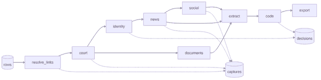

# Election Fraud Pipeline Technical Solution - Summary

Prepared by Michael Conroy for Dr. Jeffrey Treistman · October 27, 2026

(Copy of the Google Doc sent to Dr. Treistman. This is what he was told; the first pass must not contradict it.)

IRB: resolved November 21, 2026; no determination is required at this time. The guidance paragraph and decision 4 below are kept as sent.

## The question for you

I would like your decision on how deep to go with the election fraud research. The original scope was to read each of the 1,481 cases in the Heritage Foundation dataset (2000–2025), search online, and fill in the ideological motivation column. I can do that. But in planning the work I designed something more ambitious: a research pipeline that runs every case through court records, identity confirmation, news coverage and, narrowly, public social media, and records exactly which source supports every value entered in the spreadsheet.

It is an intensive system, but it is built from tools I already know and use, and I can implement it and have the first cases running within a couple of weeks. The question is whether you want the research conducted at this depth. This summary describes the approach in plain terms; a full technical specification was also created for anyone who wants the detail.

## What I am proposing

Rather than code each case by hand from whatever a web search turns up, the pipeline treats each case as a small investigation with a fixed sequence of steps, so every row is researched the same way and the evidence behind every code is kept. Your spreadsheet stays exactly as you sent it; everything the research produces goes into new columns to the right. Nothing is merged, deleted or normalized, and every row remains its own incidence.

Three things come out of the research for each case, each answerable in a different share of rows:

- **Motive type** — why the person did it: ideological or partisan cause, personal electoral gain, financial, eligibility confusion, convenience, acting for a family member, protest, official misconduct, identity concealment, or unknown. This is the variable that answers your question of why these cases happen, and it has an answer far more often than ideology does.
- **Ideological motivation** — your existing column, filled only where the motive is ideological or partisan and the record supports it.
- **Partisan direction** — who the fraud stood to benefit, which is often visible from the race even when motive is not.

Roughly 38 percent of the file is felon voting, duplicate voting and other eligibility cases where there is no ideology to find. Under a party-only scheme those are a wall of unknowns. Under a motive scheme they become a finding: eligibility confusion, convenience, caretaking. That is a substantive answer rather than a hole in the data.

## How a case moves through it

1. **Court record.** Expand the links Heritage provides, then find the primary record: a Department of Justice press release for federal cases, a state attorney general or district attorney release for state cases, and the docket, plea agreement or sentencing document where it is available online. Plea agreements and sentencing memoranda sometimes state the motive outright, and they always give the identifiers the next step needs.
2. **Identity confirmation.** Establish that the name in the row is one specific real person before anything else is attached to it. Sixty percent of the names in the file have no middle name and the surnames skew common, so this step uses a statistical method that asks how many people could plausibly share that name in that state and birth cohort. A common name with weak evidence stays unresolved and the chain stops. This is the step that prevents attributing a motive to the wrong person.
3. **News coverage.** Search local, state and national coverage of the prosecution for stated reasons, political roles, offices sought and organizational ties. For cases after 2017 this is largely automated. For earlier cases the open web has mostly rotted away and the work runs through NewsBank, which the university library licenses.
4. **Public social media.** Only for cases where identity is confirmed and the earlier steps left motive open, and only starting from an account the court record or news coverage already names. The pipeline never searches for accounts by a person's name. This step is expected to apply to a small minority of cases.
5. **Coding.** Apply the codebook's rules to the collected evidence. Every code carries an evidence tier (stated by the subject, court document, news reporting, circumstantial, or none) and a pointer to the captured source, so any value in the spreadsheet can be traced back to the sentence it rests on.

## What is automated and what stays manual

| Part of the work | How it runs |
| --- | --- |
| Expanding links and archiving pages | Fully automated |
| Federal cases (about 15 percent of the file) | Largely automated through the DOJ and CourtListener |
| State cases (about 85 percent) | Partly automated; there is no single source for state court records, so coverage is built state by state and reported |
| News coverage, 2017 onward | Largely automated |
| News coverage before 2015 | Manual, through the library's NewsBank database, one search at a time |
| Identity confirmation | Scored automatically; borderline cases reviewed by hand |
| Motive coding | Proposed from the evidence, confirmed by a human; nothing is coded without a person signing off |

The honest summary is that the automation removes the repetitive retrieval work and enforces consistency, and the judgment stays human. The pre-2015 half of the file is the schedule risk, because its news retrieval is manual by the terms of the database license.

## What building it involves

Behind the five stages is a working software system, and I want the scale of that to be visible so you can judge whether the depth is worth it. These are the engineering problems the pipeline has to solve:

- **A pipeline, not a script.** Every row moves through a fixed sequence of states, from court record found to identity confirmed to news swept to coded, tracked in a database that acts as the work queue. Any run can be stopped, resumed and rerun without losing or duplicating work, and every decision the system makes is logged so a result can be reconstructed months later. The stack is Python with a SQLite database that can move to PostgreSQL if the project grows.
- **Integrating a dozen outside systems.** The Department of Justice, CourtListener, the Internet Archive, the FEC, state legislative and campaign finance databases and the news index each have their own interface, rate limits, quirks and outages. Each needs its own client that queues requests, retries failures, caches results and respects the service's terms, so a problem with one source never stalls the run.
- **Collecting and preserving evidence.** A press release or a local news story may be gone next year. Every page the pipeline relies on is captured in the web archive format libraries use, fingerprinted with a cryptographic hash and timestamped, so any value in the workbook can be traced to the exact page as it looked on the day it was captured.
- **Reading documents.** Court filings arrive as PDFs, often scanned. Getting usable text out of them takes layout-aware parsing and optical character recognition, with quality checks so that a bad scan is flagged for a person rather than silently miscoded. Current Claude models are very good at pulling text from PDFs and scans, which is what makes this tractable; the checks exist because their errors are silent.
- **Statistical identity matching.** Deciding whether the John Smith in a 2009 court record is the John Smith in the dataset is a record linkage problem with sixty years of literature behind it. The pipeline implements a probabilistic matching model, calibrates it against hand-checked cases and reports its error rate rather than asserting matches.
- **Language models, used carefully.** A model reads the captured text and proposes a motive together with the exact passage it rests on. It is never allowed to answer from memory or from anything outside the captured evidence. Its proposals are measured against a hand-coded set of cases before they are trusted at volume, and every one is confirmed by a person.
- **Testing and reproducibility.** The code carries automated tests, pinned dependencies and a documented environment, so another researcher can run the chain from your workbook to the coded output and get the same answer. This is light work. Claude Code makes this straightforward.
- **Security and personal data.** The working dataset holds identity resolutions for named individuals. It is encrypted and kept separate from the code so the toolchain can be published without the data, and credentials for the outside services are never stored alongside it.
- **Licensing and terms of use.** Every source comes with terms: government data is public domain, court data from CourtListener has redistribution rules, the library databases forbid bulk downloading and the social platforms forbid scraping. The pipeline is built around those terms rather than against them, and the terms for each source are recorded.

*The pipeline's components. A row enters at the left and moves through link expansion, court record, identity, news and, narrowly, social media, then extraction, coding and export. Every page a stage retrieves goes to the captures store and every judgment to the decisions store.*

None of this is new ground for me. I have great experience writing software and working within highly distributed systems. That is why I can describe the system as intensive to others while also saying it's more straightforward for me to implement and kick off. The design is a final draft, the tools are mostly chosen and their interfaces verified, and the first running version is a few weeks of build rather than a research problem in itself.

## Safeguards

- **No data brokers, no voter-file profiling.** Only public records, open government data and licensed library databases are used. Party registration is never used to infer motive.
- **Public figures and private individuals are treated differently.** Candidates, officeholders and party operatives are public figures whose politics are a matter of record. Most of the people in this file are private individuals, and for them the honest code is usually a non-ideological motive or unknown.
- **Identity has a threshold.** A match is accepted only above a pre-registered confidence level, a sample of accepted matches is re-checked by hand, and the error rate is reported.
- **Platform terms are respected.** Reddit and Meta are reached only through their approved research programs if at all; nothing is scraped from sources whose terms forbid it.
- **Published code, private data.** The toolchain can be made public; the working dataset with identity resolutions stays private under your supervision.

One item I need your guidance on: whether this project has an IRB determination. Research on identifiable living individuals usually needs at least an exemption even when every source is public, and the social media step should not be built until that question is answered.

## Effort, cost and timeline

The cost is my time. There is essentially no money involved except for what I bill for in Bannerweb. The tools are free and open source, the court record and government data are free with an academic membership I can obtain, and the library already licenses the newspaper archive. A handful of accounts need to be set up in the first week, two of which take a few weeks to approve, so I would start those immediately on your go-ahead.

The foundation can be running within two weeks, and I would bring you a fifty-case pilot at that point with the first real numbers: how many cases are resolved at each step, how often identity could be confirmed, and a provisional motive distribution. From there, federal cases and recent news automate first, state records and the identity model follow, and the earlier cases run through the library archive as time allows. If the pre-2015 cases take longer than the semester, I would deliver the 2017–2025 population fully coded in January and continue the remainder into spring rather than lower the evidence standard to finish on time. Your call.

## What you would receive

- The coded workbook, your original columns untouched, with motive, partisan direction, evidence tier, identity confidence and source links for every row.
- A codebook with the taxonomy and decision rules, so a second coder or a reviewer can reproduce the coding.
- A methods appendix with the identity error rate, the extraction validation figures, inter-coder reliability on a double-coded sample, and a sensitivity check showing the findings hold under a stricter identity threshold.
- A coverage matrix recording which states' records were reachable and how, which nobody has compiled for this dataset.
- A reproducible toolchain that another researcher could run from the workbook to the coded output.

## Decisions I need from you

1. Do you want the research conducted at this depth, or at the original scope?
2. Is the population all 1,481 cases from 2000 to 2025, or the 1,252 criminal convictions only?
3. What does "independent" mean in your dropdown: ideologically centrist, registered unaffiliated, or non-partisan in direction?
4. Has the project been through IRB, and if not, who files? Is this even needed?
5. Would you be willing to code fifty cases yourself as a calibration set, so any difference between our readings of the categories surfaces before coding at volume?
6. Should identity confirmation be allowed to use a people-search service where public records run out? I have a personal BeenVerified subscription, but I have excluded data brokers by default: their results cannot be reproduced or cited by another researcher, and lookups on private individuals are exactly what an IRB will ask about.

I am happy to walk through any of this on a call. The full technical specification, with the data model, the tools used, the validation design and the system diagrams, is available on request.

*AI disclosure: This summary, the accompanying technical specification and their diagrams were written by Claude (Anthropic). The system they describe was designed with Claude's help, working from my research direction and decisions, and I edited both documents directly.*
